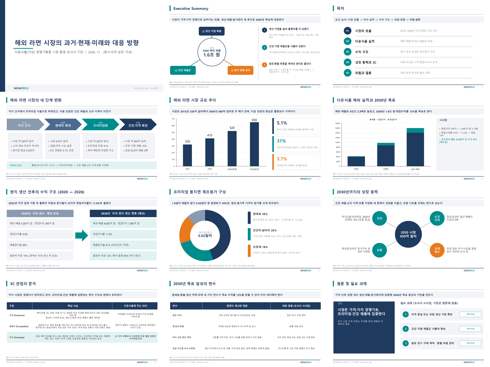
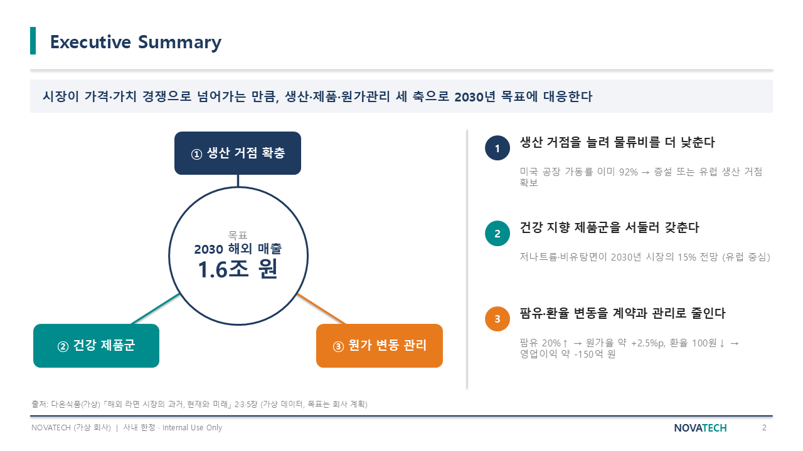
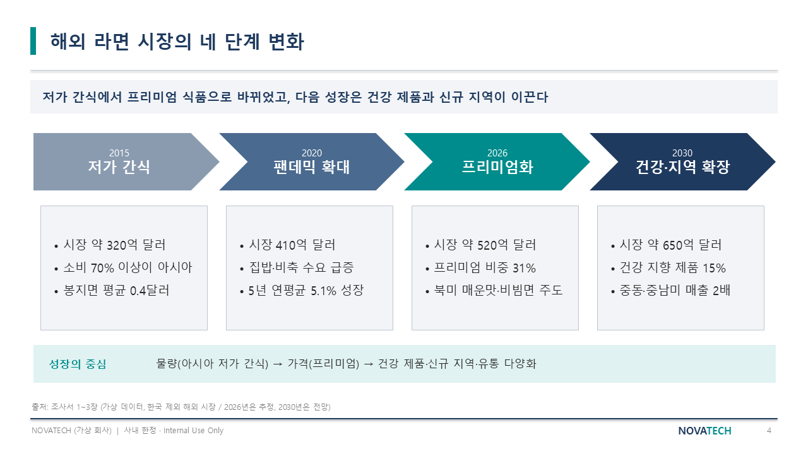
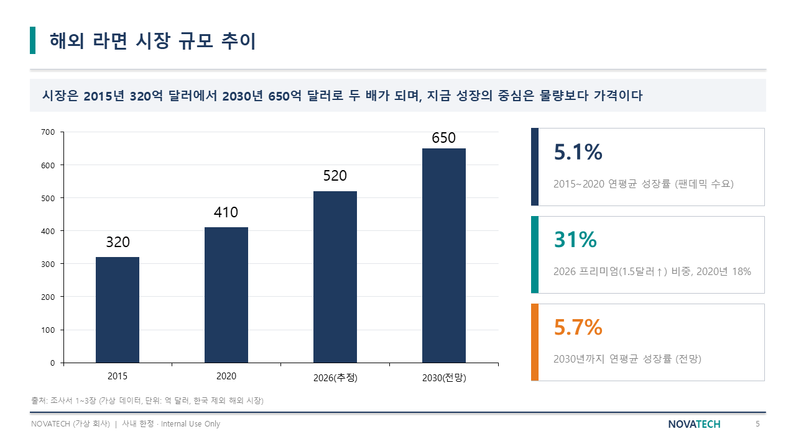
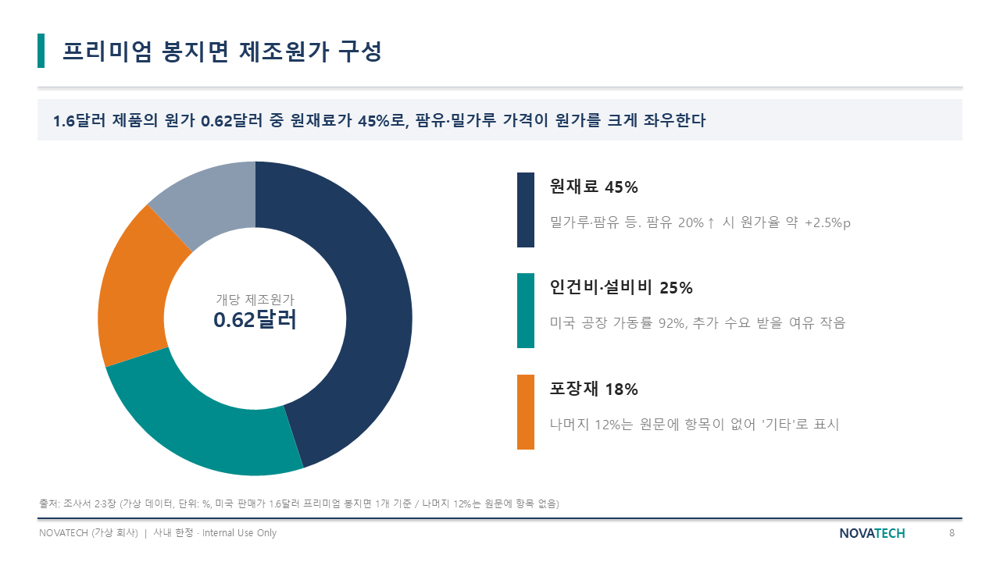
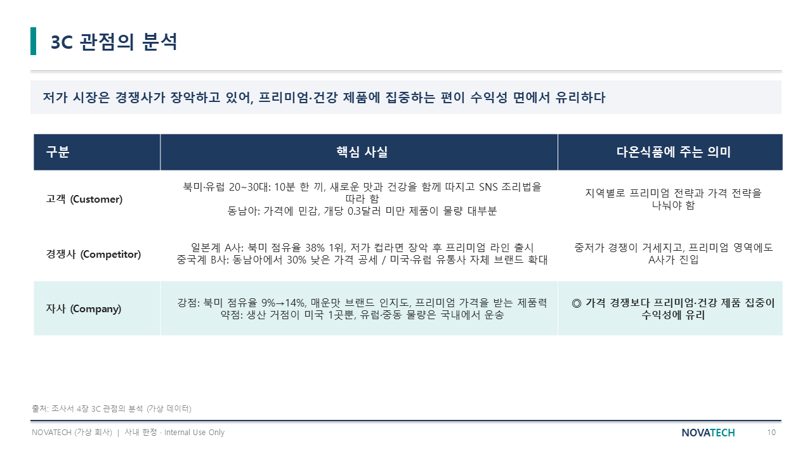
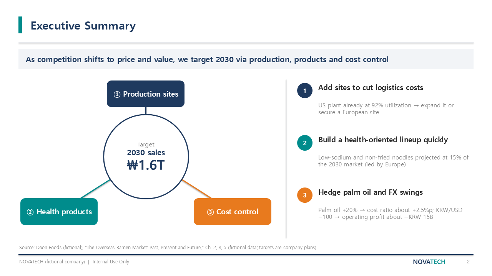
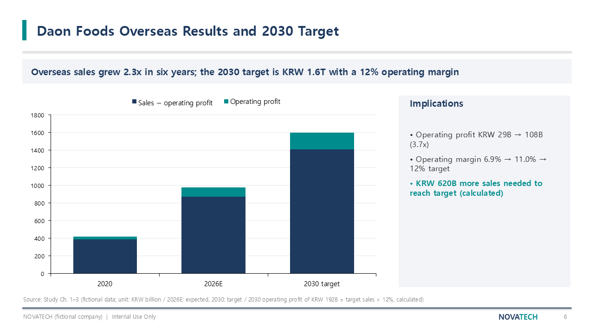

# 원본 문서 → 회사 양식 PPT 보고서 자동화 (예시)

워드로 된 조사서 한 개를 **요청 한 문장**으로 회사 양식 그대로의 PPT 보고서 12장으로 바꾼 결과물입니다.
Claude Code와 PowerPoint를 연결해 만들었고, 표와 차트는 이미지가 아니라 PowerPoint에서 바로 고칠 수 있는 개체로 남아 있습니다.

> **모든 회사명과 수치는 가상입니다.** 양식은 가상 회사 NOVATECH, 원본은 가상 회사 "다온식품"의 시장 조사서입니다.



## 요청한 문장

```
보고서자동화 스킬 사용해서, 가상_레퍼런스PPT 참고해서, 해외라면시장_가상조사서 원본을 PPT보고서로 만들어줘.
```

## 결과물

| 파일 | 내용 |
|---|---|
| [report_ko.pptx](report_ko.pptx) | 한국어 보고서 12장 |
| [report_en.pptx](report_en.pptx) | 같은 보고서의 영어판 (단위를 $B / KRW B로 변환) |

## 장표 예시

**한 장 요약 (Executive Summary)** — 왼쪽 관계도와 오른쪽 핵심 문장이 번호로 짝을 이룹니다.



**시장의 네 단계** — 레퍼런스의 단계 화살표 장표를 내용에 맞게 바꿨습니다.



**차트 + 핵심 수치** — 차트는 PowerPoint 차트라 숫자를 고치면 막대도 바뀝니다.





**표** — 레퍼런스의 6칸 표를 3칸으로 줄이고, 가장 중요한 줄만 강조했습니다.



**영어판**





## 만든 방식

1. 회사 양식(레퍼런스 PPT) 12장의 구도·색·글꼴을 분석
2. 원본 조사서에서 결론·근거·수치를 뽑아 장표 순서 구성
3. 레퍼런스 복사본 위에서 PowerPoint를 직접 조작해 글자·표·차트 교체
4. 전 장을 이미지로 내보내 검수하고, 발견한 오류(빈 차트, 잘린 막대)를 수정

원본에 없는 수치나 기한은 지어내지 않고 "원문 미기재", "기한 미정"으로 표시했습니다.

## 필요한 환경

- Windows PC + Microsoft PowerPoint 설치형
- Claude Code (Claude 유료 구독)
